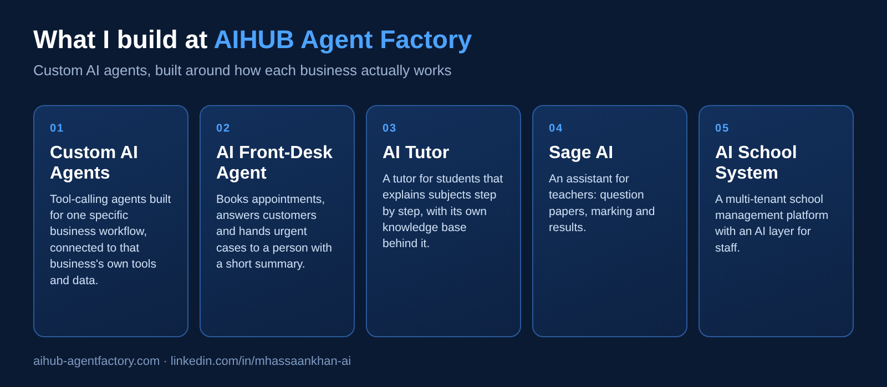

# Hi, I'm M.Hassaan Khan

**Agentic AI Engineer | I build custom AI agents for businesses**

Founder of AIHUB Agent Factory · Faculty Head & Mentor at AI HUB · Gujranwala, Pakistan

I design and build custom AI agents that take over repetitive work in a business: answering customer enquiries, booking appointments, following up leads, handling routine tasks, and handing real cases to a person. Every agent is built around the way that business actually works. I have trained 100+ developers in AI engineering and agentic systems.

## What I'm building

- **Custom AI agents**: tool-calling agents built for a specific business workflow and connected to its own tools and data
- **AI front-desk agent**: a multi-tenant platform that books appointments, answers customers and hands urgent cases to a human, with a short summary
- **AI tutor for students**: an AI tutoring platform with a retrieval-based knowledge base
- **Sage AI**: a grading and paper-generation assistant for teachers
- **AI School System**: a multi-tenant school management platform (students, fees, exams) with an AI layer

## Tech stack

**Frontend:** Next.js, React
**Backend:** Node.js / Express, Python (FastAPI)
**Data:** Supabase (PostgreSQL)
**AI:** agentic workflows, tool-calling agents, retrieval (RAG), multiple LLMs
**Automation:** n8n, API integrations
**Deploy:** Vercel, Render

## Let's talk

- Website: https://aihub-agentfactory.com
- LinkedIn: https://www.linkedin.com/in/mhassaankhan-ai
- Fiverr: @hassaankhan306
- Upwork: https://www.upwork.com/freelancers/~01b094ff8b2327e7c9
