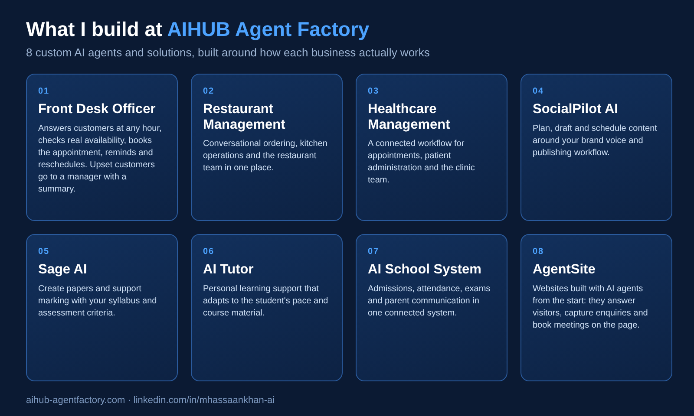

# Hi, I'm M.Hassaan Khan

**Agentic AI Engineer | I build custom AI agents for businesses**

### 100+ developers trained · 100+ happy clients

Most businesses lose customers to slow replies and missed follow-ups. I build the AI agent that takes that work over.

Founder of AIHUB Agent Factory · Faculty Head & Mentor at AI HUB · Gujranwala, Pakistan

I design and build custom AI agents that take over repetitive work in a business: answering customer enquiries, booking appointments, following up leads, handling routine tasks, and handing real cases to a person. Every agent is built around the way that business actually works. I have trained 100+ developers in AI engineering and agentic systems.

## What I'm building

- **Front Desk Officer**: answers customers at any hour, checks real availability, books the appointment, reminds and reschedules; an upset customer is handed to a manager with a summary
- **Restaurant Management**: conversational ordering, kitchen operations and the restaurant team in one place
- **Healthcare Management**: a connected workflow for appointments, patient administration and the clinic team
- **SocialPilot AI**: plans, drafts and schedules content around a brand voice and publishing workflow
- **Sage AI**: creates papers and supports marking with your syllabus and assessment criteria
- **AI Tutor**: personal learning support that adapts to the student's pace and course material
- **AI School System**: admissions, attendance, exams and parent communication in one connected system
- **AgentSite**: websites built with AI agents from the start, answering visitors, capturing enquiries and booking meetings on the page

See them all at https://aihub-agentfactory.com

## Tech stack

**Frontend:** Next.js, React
**Backend:** Node.js / Express, Python (FastAPI)
**Data:** Supabase (PostgreSQL)
**AI:** agentic workflows, tool-calling agents, retrieval (RAG), multiple LLMs
**Automation:** n8n, API integrations
**Deploy:** Vercel, Render

## Let's talk

- Website: https://aihub-agentfactory.com
- LinkedIn: https://www.linkedin.com/in/mhassaankhan-ai
- Fiverr: @hassaankhan306
- Upwork: https://www.upwork.com/freelancers/~01b094ff8b2327e7c9
